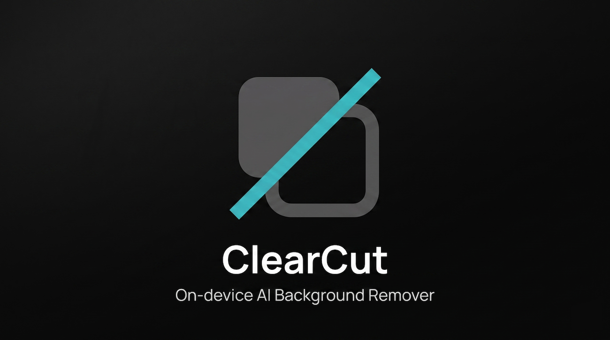

<div align="center">

<!--
  IMAGE 1 — Logo / Hero banner
  Suggested: a clean banner (1280×400px approx.) featuring the ClearCut
  logo mark (the overlapping squares icon used in the app header) next to
  the "ClearCut" wordmark, on a dark background (#060a10) with the cyan/teal
  gradient glow used throughout the UI. This sets the tone before anyone
  reads a single line of text.
-->
<a href="https://marcantero.github.io/ClearCut/">
  
</a>

**Privacy-first, in-browser AI background removal.**
No uploads. No servers. No tracking. Just your browser and your GPU/CPU.

[Website](https://marcantero.github.io/ClearCut/) · [Report a Bug](https://github.com/marcantero/ClearCut/issues) · [Request a Feature](https://github.com/marcantero/ClearCut/issues)

</div>

<!--
  IMAGE 2 — Main product screenshot / GIF
  Suggested: a screen recording (GIF or MP4 converted to GIF) showing the
  full flow: drag an image into the dropzone → AI processing indicator →
  before/after compare slider revealing the cut-out result. Capture both
  light and dark mode if possible, or pick the mode you prefer as the
  primary showcase. Ideal size: 1280×800px or similar 16:10 ratio.
-->
<div align="center">
  
</div>

<br />

## Overview

ClearCut is a web application that removes the background from any photo entirely **on-device**, using a machine learning model that runs locally in the browser via [Transformers.js](https://huggingface.co/docs/transformers.js). Images are never uploaded to a server — all inference happens client-side, inside a dedicated Web Worker, so the tab stays responsive while the model runs.

Beyond automatic background removal, ClearCut includes an interactive **mask refinement editor** with a Photoshop-style smart brush, letting users restore or erase parts of the AI-generated mask with pixel-level precision before exporting a transparent PNG.

This project was built as a personal exploration of running production-grade computer vision models fully client-side, combined with a polished, modern UI/UX.

<br />

## Key Features

- **100% local processing** — the AI model is downloaded once and runs entirely in your browser. No image data ever leaves the tab.
- **Drag-and-drop upload** — simple, fast image input via a dedicated dropzone component.
- **Background removal powered by Transformers.js** — runs a segmentation model on-device using WebAssembly/WebGPU, offloaded to a Web Worker to keep the UI thread free.
- **Before/after compare slider** — interactively reveal the processed result against the original image.
- **Smart brush mask editor** — a Quick Selection–style tool that lets you restore or erase mask areas with adjustable brush size and color-similarity tolerance.
- **Light / dark mode** — fully themed interface with persisted user preference.
- **One-click PNG export** — download the final cut-out image with a transparent background.
- **Zero backend** — a fully static site, deployable to GitHub Pages or any static host.

<br />

<!--
  IMAGE 3 — Mask refinement editor
  Suggested: a screenshot of the editor mode (the split-panel layout) showing
  the smart brush in action — ideally mid-stroke, with the brush cursor
  visible and a visible "before/after" difference in the mask. This is the
  most technically interesting feature, so a clear, well-lit screenshot
  (or short GIF) helps a lot here. Approx. 1280×720px.
-->
<div align="center">
  
</div>

<br />

## Tech Stack

| Layer | Technology |
|---|---|
| UI Framework | [React 18](https://react.dev/) + [TypeScript](https://www.typescriptlang.org/) |
| Build Tool | [Vite 5](https://vitejs.dev/) (`@vitejs/plugin-react-swc`) |
| Styling | [Tailwind CSS 3](https://tailwindcss.com/) |
| AI / ML Inference | [`@huggingface/transformers`](https://huggingface.co/docs/transformers.js) (Transformers.js) |
| Concurrency | Web Worker (off-main-thread inference) |
| Image Processing | Canvas API (`ImageData`, pixel-level mask compositing) |
| Notifications / Toasts | [`sileo`](https://www.npmjs.com/package/sileo) |
| Deployment | GitHub Pages (`gh-pages`) |

<br />

## How It Works

1. **Upload** — the user drops an image into the `Dropzone` component. The file is decoded into raw `ImageData` on the main thread.
2. **Inference** — the image is dispatched to a background `Worker` (via the `useBackgroundWorker` hook), which runs the segmentation model loaded through `@huggingface/transformers`. The main thread stays fully responsive while this happens.
3. **Result** — the worker returns a processed `ImageData` mask, which is rendered as a transparent-background PNG and shown in an interactive **before/after compare slider**.
4. **Refinement (optional)** — the user can enter the editor view (`MaskEditorOverlay`), where a smart brush tool allows manually restoring or erasing parts of the mask based on adjustable brush size and color-similarity tolerance — without ever leaving the browser or re-uploading anything.
5. **Export** — the final image is composited on a `<canvas>`, converted to a PNG `Blob`, and downloaded directly — no server round-trip at any point in the pipeline.

<br />

## Getting Started

### Prerequisites

- [Node.js](https://nodejs.org/) 18 or later
- npm (bundled with Node.js)

### Installation

```bash
# Clone the repository
git clone https://github.com/marcantero/ClearCut.git
cd ClearCut

# Install dependencies
npm install

# Start the development server
npm run dev
```

> **Note:** on first load, the AI model will be downloaded and cached by the browser. This may take a few seconds depending on your connection — subsequent loads will be much faster.

### Available Scripts

| Command | Description |
|---|---|
| `npm run dev` | Starts the Vite development server with hot reload |
| `npm run build` | Builds the app for production into `dist/` |
| `npm run preview` | Serves the production build locally for testing |
| `npm run deploy` | Builds and publishes the app to GitHub Pages |

<br />

## Project Structure

```
ClearCut/
├── public/                  # Static assets
├── src/
│   ├── components/
│   │   ├── Dropzone.tsx           # Drag-and-drop image upload
│   │   ├── ImageCompareSlider.tsx # Before/after interactive slider
│   │   └── MaskEditorOverlay.tsx  # Smart brush mask refinement editor
│   ├── hooks/
│   │   └── useBackgroundWorker.ts # Web Worker lifecycle & messaging
│   ├── lib/
│   │   └── imageUtils.ts          # Image decoding / encoding helpers
│   ├── App.tsx               # Application shell and view orchestration
│   └── index.css             # Tailwind layers + custom UI animations
├── package.json
├── tailwind.config.cjs
├── vite.config.ts
└── tsconfig.json
```

<br />

## Roadmap

Tasks are grouped by priority. Tick them off as they land.

### 🔴 P0 — Model selector bugs

- [x] Pass the model id explicitly to `processImage` (first upload failed with "No model selected" due to stale React state)
- [x] Fix the type error when calling `processImage` with 3 arguments
- [x] Show the correct model name (card says "RMBG-2.0" but loads `briaai/RMBG-1.4`; worker progress message hardcodes "RMBG-1.4")
- [x] Worker: don't cache a failed model load, so the same model can be retried
- [x] Worker: `dispose()` the previous pipeline when switching models (GPU/WASM memory leak)
- [x] Worker: type incoming/outgoing messages instead of using `any`
- [x] Re-process the current image when the user switches model

### 🟠 P1 — Output quality & performance

- [ ] Export at the original resolution (run the model at ≤1024 px, upscale the mask, apply it to the full-size image)
- [ ] Use blob URLs (`toBlob` + `createObjectURL`) instead of base64 data URLs; download straight from `ImageData`
- [ ] Delay `URL.revokeObjectURL` after triggering the download
- [ ] Try `fp16` on WebGPU instead of `fp32` to reduce model download size
- [ ] Show approximate model size on each card; don't start a heavy download on a simple card click
- [ ] Mask editor: throttle the freehand brush with `requestAnimationFrame` and use `willReadFrequently` contexts
- [ ] Mask editor: reduce undo history memory (currently ~250 MB at 1024² — store masks only, or dirty rectangles)

### 🟡 P2 — Tooling & code quality

- [ ] Type-check on build (`tsc --noEmit && vite build`) and add a `typecheck` script
- [ ] Add ESLint (`typescript-eslint` + `react-hooks`)
- [ ] Add Vitest unit tests for `refineMask`, `getScaledSize` and the correction-mask merge
- [ ] GitHub Action to build and deploy to GitHub Pages
- [ ] Remove dead code: `ModelStatusBanner.tsx`, `useFloodFill.ts`, unused `threshold` field
- [ ] Move `MODELS` to `src/config/models.ts` and split `App.tsx` into `Header`, `ModelPicker`, `EditorLayout`, `LoadingOverlay`
- [ ] Fix inconsistent config: `package.json` `homepage` vs Vite `base`, header GitHub link, `.gitignore` entries for tracked public assets, missing `assets/clearcut-demo.gif`

### 🔵 P3 — UI, accessibility & consistency

- [ ] Fix the `Toaster` setup: it uses `sonner`-style props (`id`, `expand`, `toastOptions`, …) that `sileo` silently ignores
- [ ] Remove leftovers of the old red theme (error status pill, toast borders, loading overlay shadow) and fix the inverted toast theme
- [ ] Make the Dropzone readable in light mode
- [ ] Dropzone: paste image from clipboard (Ctrl+V), toast on non-image files, keyboard accessibility
- [ ] Mask editor: Pointer Events + `setPointerCapture` for touch/stylus support
- [ ] Mask editor: zoom & pan, keyboard shortcuts (`[` / `]` brush size, tool switching)
- [ ] Loading overlay: fix spinner (`animate-spin` overrides inline rotation), allow cancelling, respect `prefers-reduced-motion`
- [ ] Unify UI language (some strings are in Catalan) or add i18n

### ✨ New features

- [ ] Background replacement (solid colour, blur, custom image)
- [ ] Additional export formats (WebP, JPEG with background, auto-crop to subject)
- [ ] Copy result to clipboard
- [ ] Batch processing with ZIP download
- [ ] PWA support for fully offline usage

<br />

## Contributing

Contributions, issues, and feature requests are welcome. Feel free to check the [issues page](https://github.com/marcantero/ClearCut/issues) or open a pull request.

1. Fork the project
2. Create your feature branch (`git checkout -b feature/amazing-feature`)
3. Commit your changes (`git commit -m 'Add some amazing feature'`)
4. Push to the branch (`git push origin feature/amazing-feature`)
5. Open a Pull Request

<br />

## License
 
This project is licensed under the **Apache License 2.0** — see the [LICENSE](./LICENSE) file for details.
 
<br />

## Acknowledgments

- [Transformers.js](https://huggingface.co/docs/transformers.js) by Hugging Face, for making client-side ML inference practical in the browser.
- [Vite](https://vitejs.dev/) for the build tooling.

<br />

<div align="center">

Built by [Marc Cantero](https://github.com/marcantero)

</div>
